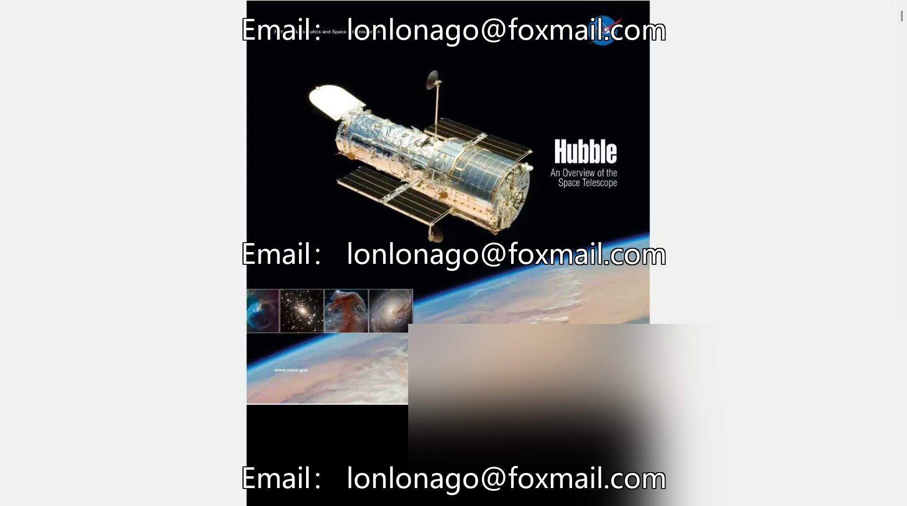
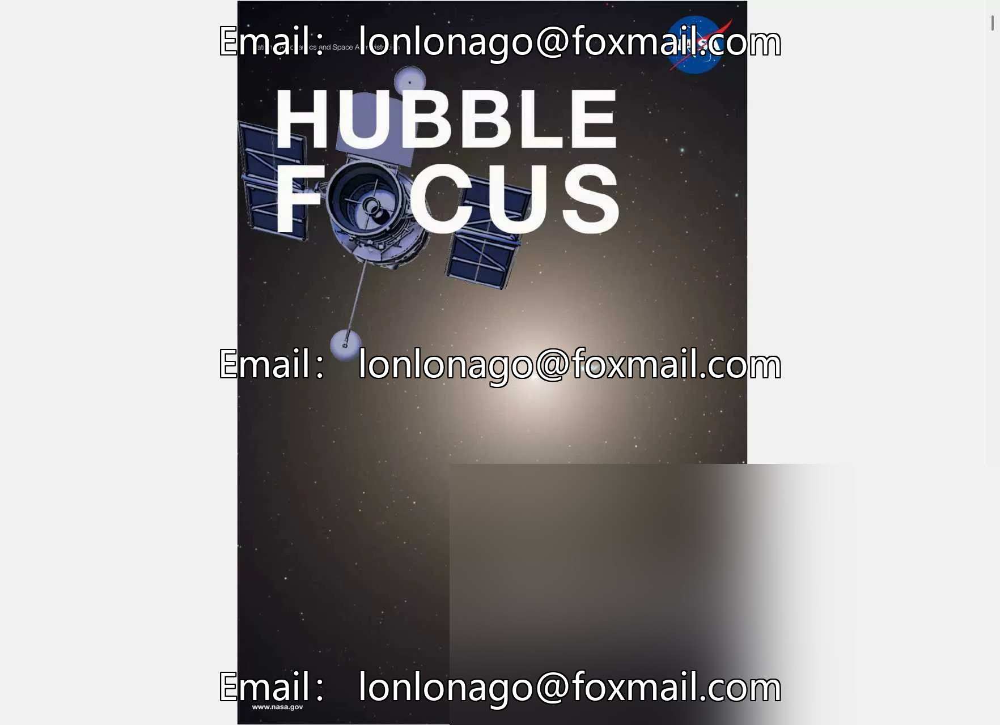
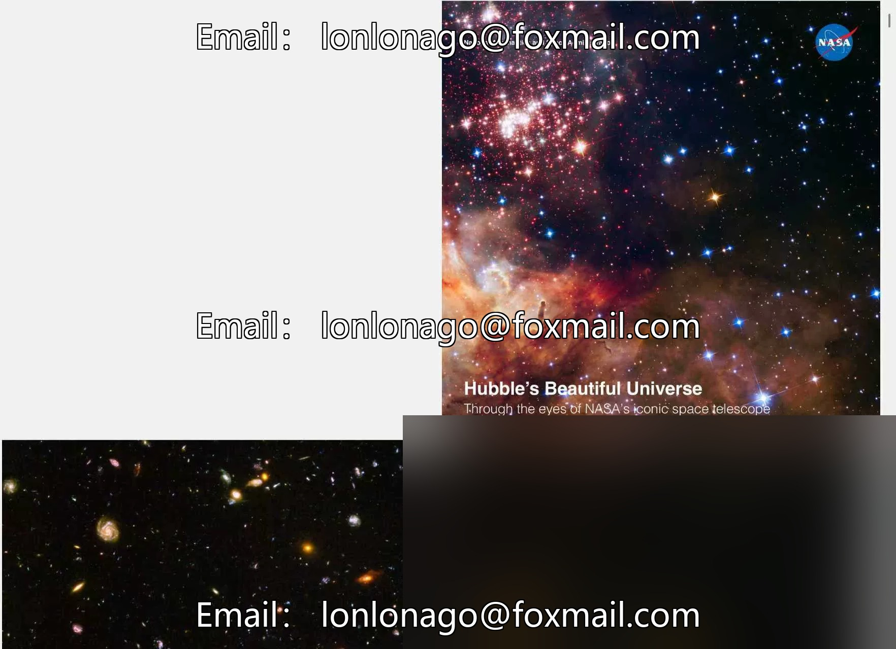
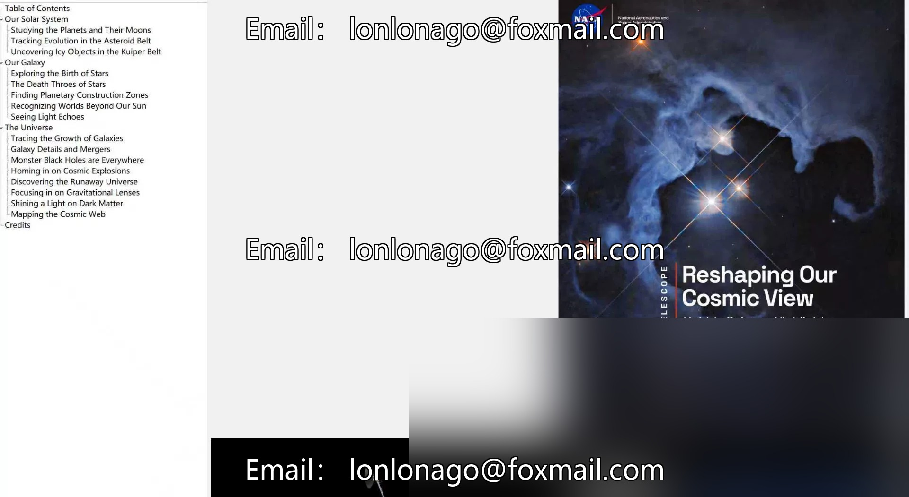
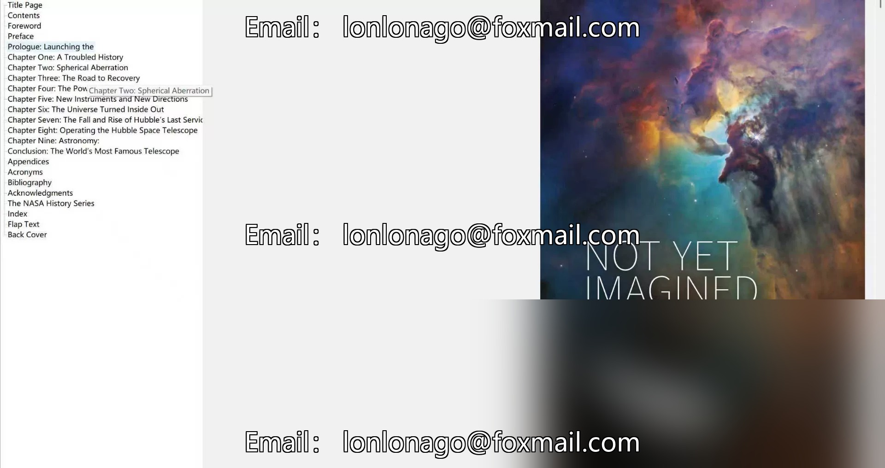
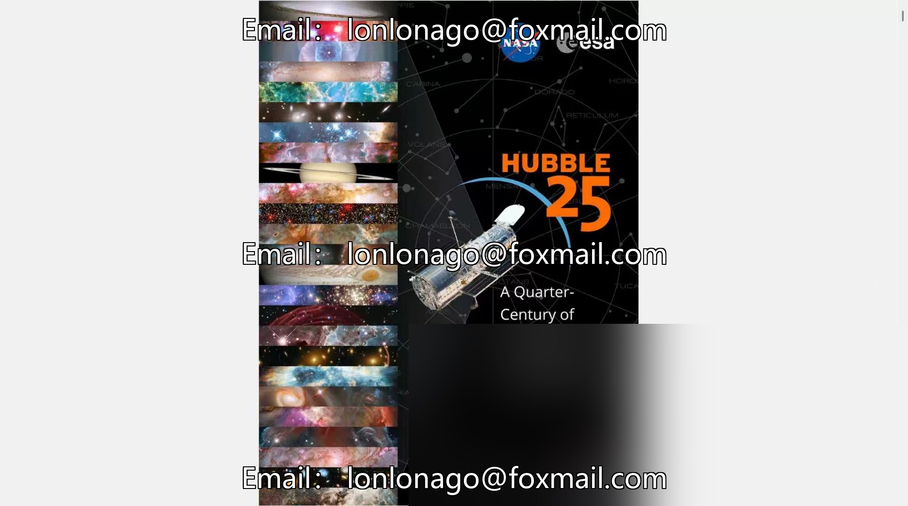
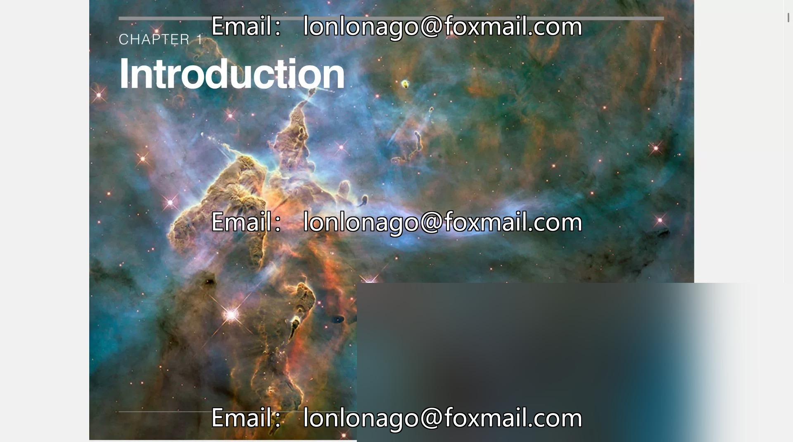
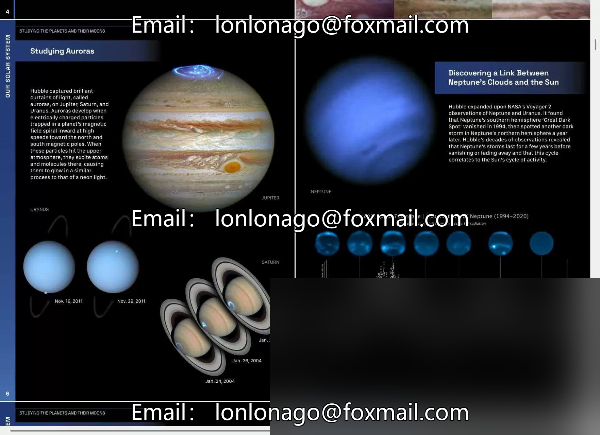

# Hub Space Telescope related electronic data , produced by NASA officially, covering content such as Hub

## Body

Hub space telescope related electronic data collection. NASA official production Content covers Hubb's thirty years of achievements. Scientific discovery Black hole research Thematic observations such as cosmic observation. Materials are rich Suitable for astronomical enthusiasts Space enthusiasts Academic learning reference.
9 copies
The materials are in PDF format, with detailed content; the will be shipped, and no return or exchange is accepted.

Need to take a direct photo, and for any issues, message privately.

The collection is produced by NASA official, covering Hubble's thirty-year achievements, scientific discoveries, black hole research, cosmic observations, and is in 9 PDFs with detailed content.

<!-- AI_ENRICHED -->

## Images

## Payment

Here is a pay link on Stripe ( https://buy.stripe.com/3cs8yP7sY87d0vu9AB ). Please contact me lonlonago@foxmail.com after funding $89, and I will send you a complete data files , thank you!

